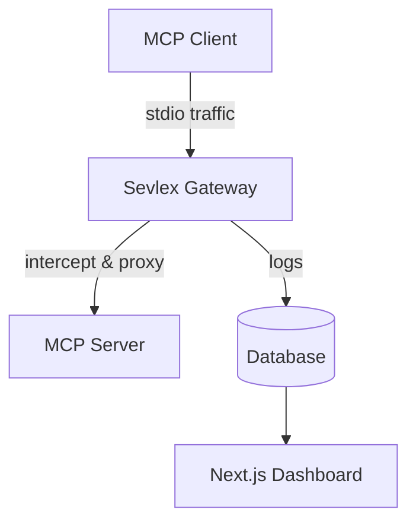

<div align="center">
  <h1>🛡️ Sevlex</h1>
  <p><b>The Ultimate Layer 7 Zero-Trust MCP Firewall</b></p>
</div>

## 🌟 Overview
Sevlex is an enterprise-grade MCP Gateway MVP designed to intercept, monitor, and secure `stdio` traffic for Model Context Protocol (MCP) servers. With real-time Deep Packet Inspection (DPI) and robust identity tracking, Sevlex ensures zero-trust security at Layer 7.

## 🏗️ Architecture



## ✨ Features
- **Real-Time DPI**: Deep Packet Inspection for MCP JSON-RPC traffic.
- **Identity Tracking**: Monitor and trace requests to specific client identities.
- **Slack Webhooks**: Receive instant alerts for anomalous traffic.
- **API Security**: Prevent unauthorized tool execution and secure your infrastructure.

## 🚀 Quickstart

1. **Install Dependencies**
   ```bash
   # Install dependencies
   cd gateway && npm install
   cd ../dashboard && npm install
   cd ..
   ```

2. **Run Sevlex**
   Start both the gateway and the dashboard simultaneously:
   ```bash
   start.bat
   ```
