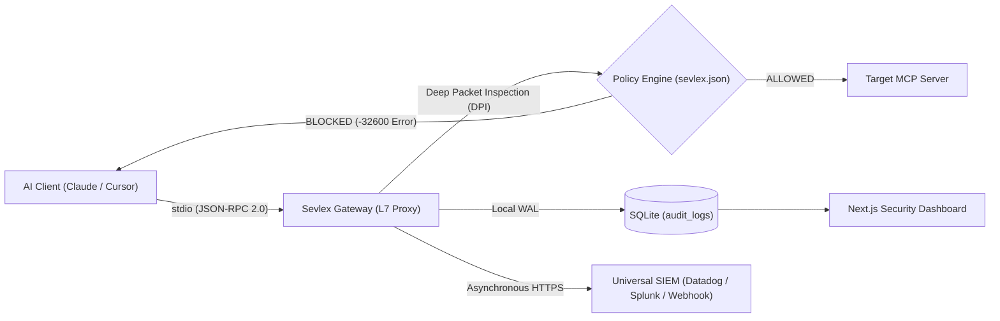

<div align="center">
  <h1>🛡️ Sevlex</h1>
  <p><b>Open-Source Layer 7 Zero-Trust Security Firewall for Model Context Protocol (MCP)</b></p>
  <p><i>Real-time DPI • Stdio Stream Interception • Universal SIEM Streaming • Zero-Touch MDM Rollout</i></p>
</div>

---

## 🌟 Overview

**Sevlex** is an open-source, on-premise Layer 7 proxy designed to monitor, intercept, and enforce security policies on Model Context Protocol (MCP) tool executions. Sitting transparently between AI clients (such as Claude Desktop, Cursor, or custom agents) and local MCP tool processes, Sevlex inspects JSON-RPC 2.0 traffic in real time, preventing unauthorized command execution, destructive database mutations, and sensitive data exfiltration.

---

## 🏗️ Architecture



---

## ✨ Core Capabilities

- **Deterministic Stream Parser**: Uses a bracket-balanced iterative state machine to handle fragmented, multi-line JSON-RPC payloads over `stdio` without failing open.
- **Spec-Compliant Enforcement**: Returns standard JSON-RPC `-32600` access denied errors on blocked tool calls so AI clients recover gracefully without process hanging.
- **Stateless Disaster Recovery**: Streams audit receipts asynchronously via HTTPS to corporate SIEMs (**Datadog**, **Splunk**, or **HTTP Webhooks**) for zero-data-loss compliance and multi-region replication.
- **Local Low-Latency Audit Receipts**: Synchronously writes audit records to a local WAL-mode SQLite database (`audit_log.db`) for developer inspection.
- **Identity & Context Attribution**: Automatically binds OS usernames and environment tokens (`SEVLEX_USER`) to every tool invocation.
- **Zero-Touch Enterprise MDM Rollout**: Includes turnkey rollout scripts for **Jamf Pro**, **Kandji**, and **Microsoft Intune** to secure entire engineering fleets silently.
- **Next.js Observability Dashboard**: Built-in dark-mode dashboard with real-time audit log viewer, tool execution metrics, and dynamic policy toggles.

---

## 🚀 Quickstart

### 1. Prerequisites
- Node.js 18+
- npm or pnpm

### 2. Installation & Setup
```bash
# Clone the repository
git clone https://github.com/meetpanchal-sevlex/sevlex-mcp-gateway.git
cd sevlex-mcp-gateway

# Install dependencies
cd gateway && npm install
cd ../dashboard && npm install
cd ..
```

### 3. Launching Sevlex
To run both the gateway and the security dashboard simultaneously:
```bash
start.bat
```

Alternatively, run each service independently:
```bash
# Terminal 1: Security Gateway
cd gateway
npx tsx src/gateway.ts <target-command> [target-args]

# Terminal 2: Security Dashboard
cd dashboard
npm run dev
```

---

## ⚙️ Configuration (`sevlex.json`)

```json
{
  "version": "1.0",
  "policy": {
    "defaultAction": "ALLOW",
    "blockedTools": [
      "execute_arbitrary_shell",
      "drop_tables",
      "export_customer_data"
    ],
    "siem": {
      "enabled": true,
      "provider": "datadog",
      "endpoint": "https://http-intake.logs.datadoghq.com/api/v2/logs",
      "apiKey": "YOUR_DATADOG_API_KEY"
    }
  }
}
```

---

## 🏢 Enterprise Fleet Deployment (MDM)

Sevlex provides zero-touch deployment scripts for enterprise IT operations:

- **macOS / Linux (Jamf Pro, Kandji, Munki)**: `deploy/deploy-mdm.sh`
- **Windows (Microsoft Intune, SCCM, GPO)**: `deploy/deploy-mdm.ps1`
- **Enterprise Policy Template**: `deploy/sevlex.enterprise.json`

---

## 📄 License

MIT License. Designed and maintained by Meet Panchal.
