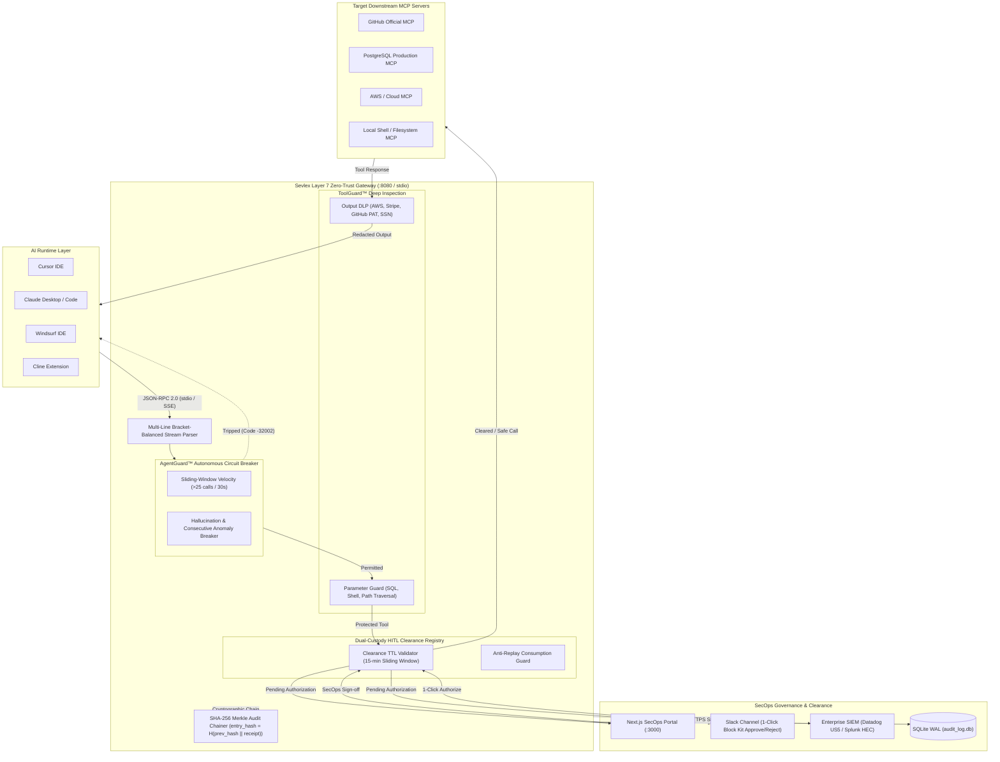

<div align="center">
  <h1>🛡️ Sevlex</h1>
  <p><b>Layer 7 Zero-Trust Security Gateway & Control Plane for the Model Context Protocol (MCP)</b></p>
  <p><i>Real-Time Deep Packet Inspection • Autonomous AgentGuard™ Circuit Breaker • In-Flight Output DLP • Dual-Custody Slack HITL • SOC 2 Merkle Audit Chaining</i></p>

  <p>
    <a href="https://github.com/meetpanchal-sevlex/sevlex-mcp-gateway/actions"></a>
    
    
    
    
  </p>
</div>

---

## 🌟 Executive Overview

**Sevlex** is an enterprise-grade, Layer 7 Zero-Trust security gateway and runtime control plane designed to govern Model Context Protocol (MCP) tool executions across developer workstations, autonomous agent runtimes, and air-gapped VPCs.

Sitting transparently between AI clients (Cursor, Claude Desktop, Windsurf, Cline, Claude Code) and downstream MCP servers, Sevlex performs sub-millisecond Deep Packet Inspection (DPI) on JSON-RPC 2.0 traffic over `stdio` and `SSE` streams. It arrests dangerous SQL injections, path traversals, and arbitrary shell executions, redacts sensitive corporate credentials in-flight, breaks agent hallucination loops, and enforces dual-custody Human-In-The-Loop (HITL) sign-offs via 1-click Slack interactive cards.

---

## 🏗️ Architecture & Control Plane



---

## 🥊 Competitive Parity Matrix

| Feature / Architecture Dimension | Sevlex Enterprise Gateway | Runlayer | Preloop | Traditional API Gateways (Kong / Envoy) |
| :--- | :---: | :---: | :---: | :---: |
| **Layer 7 Parameter DPI (SQL, Shell, Traversal)** | **✔ Active In-Flight** | ⚠️ Server-Level | ✔ Policy Engine | ❌ L4 / REST HTTP Only |
| **In-Flight Output DLP (AWS, Stripe, PAT, SSN)** | **✔ Sub-millisecond Regex** | ⚠️ Partial | ⚠️ Pre-release | ❌ None |
| **AgentGuard™ Hallucination Loop Breaker** | **✔ Stateful (Velocity + Anomaly)** | ❌ None | ❌ None | ⚠️ Simple Rate Limiting |
| **1-Click Slack Dual-Custody HITL** | **✔ Native Block Kit Interactive** | ⚠️ Connector Auth Only | ✔ Slack Webhook | ❌ Manual Webhooks |
| **SOC 2 Cryptographic Merkle Audit Hash Chain** | **✔ SHA-256 Chain Verification** | ❌ Centralized SaaS Logs | ❌ Standard JSON Logs | ❌ External SIEM Dependent |
| **Zero-Touch Client Auto-Patcher (`sevlex inject`)** | **✔ 6 AI Clients Supported** | ⚠️ Proprietary Agent | ❌ Manual Config | ❌ Not Supported |
| **Tamper-Resistant 30ms Auto-Heal Daemon** | **✔ Active 24/7 File Watcher** | ✔ Runlayer Watch | ❌ Manual Restart | ❌ Not Supported |
| **Air-Gapped VPC Deployment (Docker Compose)** | **✔ Single-Command Self-Hosted** | ❌ SaaS Hosted Only | ✔ Open Source | ✔ Self-Hosted |
| **Dynamic Policy Hot-Reloading (<5ms)** | **✔ Zero-Restart In-Memory** | ⚠️ Remote Push | ⚠️ File Restart | ✔ Dynamic Route Sync |

---

## 🛡️ Core Security Capabilities

### 1. ToolGuard™ Deep Parameter Guard & Output DLP
* **Parameter Guard**: Intercepts `tools/call` JSON-RPC payloads before execution. Blocks dangerous destructive SQL commands (`DROP TABLE`, `TRUNCATE`, `ALTER TABLE`), command injection primitives (`; rm -rf`, `&& cat /etc/shadow`), and directory traversal (`../../.ssh/id_rsa`).
* **In-Flight Output DLP**: Intercepts downstream MCP responses before the LLM ingests them. Redacts high-entropy AWS access keys (`AKIA...`), Stripe live tokens (`sk_live_...`), GitHub Personal Access Tokens (`ghp_...`), and Social Security Numbers (`SSN`).

### 2. AgentGuard™ Autonomous Circuit Breaker
Designed to eliminate catastrophic autonomous AI agent failure modes:
* **Velocity Limiter**: Halts sessions exceeding 25 tool calls per 30 seconds.
* **Consecutive Failure Breaker**: Automatically trips when an agent encounters 5 consecutive permission failures.
* **Identical Call Loop Breaker**: Detects runaway hallucinations when an agent re-executes the exact same tool and arguments 3 consecutive times. Returns standard JSON-RPC `-32002` error codes so agents pause gracefully.

### 3. Dual-Custody HITL Closed Clearance Loop with 1-Click Slack Action Buttons
* Protected high-impact tools (`drop_database`, `github_merge_to_main`, `aws_terminate_instance`) are automatically suspended.
* Dispatches a rich Slack Block Kit card to `#secops-alerts` with action buttons: `[ ✅ Authorize (15m Window) ]` and `[ ❌ Reject & Terminate ]`.
* SecOps authorizes with one tap on their laptop or phone. Slack sends an interactive event to `/api/hitl/slack`, updating the card in-place with an immutable cryptographic signature.
* Retrying agents are granted seamless execution; clearances are atomically consumed (`CONSUMED`) to guarantee anti-replay security.

### 4. Cryptographic SHA-256 Merkle Audit Chain (SOC 2 Non-Repudiation)
Every execution receipt recorded in SQLite WAL mode is mathematically bound to its predecessor:
$$\text{entry\_hash} = \text{SHA256}(\text{prev\_hash} \parallel \text{id} \parallel \text{user\_id} \parallel \text{tool\_name} \parallel \text{status} \parallel \text{raw\_request} \parallel \text{timestamp})$$
Run `sevlex verify` at any time to mathematically audit the entire history. Any database record alteration, tampering, or deletion breaks the hash chain instantly.

---

## ⚡ CLI Command Reference

Sevlex includes a unified enterprise CLI (`sevlex`):

```bash
# Auto-patch and wrap MCP servers across all detected AI runtimes
sevlex inject

# Unhook Sevlex and atomically restore original client configs from backup
sevlex restore

# Cryptographically verify the SHA-256 Merkle audit chain for SOC 2 audits
sevlex verify

# Query active dual-custody HITL clearance tickets
sevlex hitl

# Inspect endpoint security health, active policies, and shielded runtimes
sevlex status

# Discover unmanaged shadow AI MCP servers across all user profiles
sevlex scan

# Launch remote MCP Server-Sent Events (SSE) reverse proxy
sevlex sse 8080 http://localhost:3001/sse

# Launch 24/7 background watcher daemon with 30ms tamper auto-healing
sevlex daemon

# Execute target tool transparently wrapped by Layer 7 zero-trust proxy
sevlex npx -y @modelcontextprotocol/server-github
```

---

## 🚀 Quickstart

### 1. Prerequisites
- Node.js 20+
- npm or pnpm
- Docker & Docker Compose (optional, for VPC deployment)

### 2. Local Setup
```bash
# Clone the repository
git clone https://github.com/meetpanchal-sevlex/sevlex-mcp-gateway.git
cd sevlex-mcp-gateway

# Install dependencies
cd gateway && npm ci
cd ../dashboard && npm ci
cd ..
```

### 3. Running the Verification Suite
```bash
# Run strict TypeScript compilation
cd gateway && npx tsc --noEmit
cd ../dashboard && npx tsc --noEmit

# Run 8-stage live security simulation suite
cd ../gateway && npm run simulate

# Verify cryptographic audit integrity
node bin/sevlex.js verify
```

### 4. Self-Hosted VPC Deployment (Docker Compose)
Deploy the full gateway, SQLite WAL persistent volume, and SecOps dashboard:
```bash
# Copy environment configuration
cp .env.example .env

# Boot gateway and dashboard
docker compose up -d

# Verify container health
curl -f http://localhost:3000/api/health
```

---

## ⚙️ Configuration (`sevlex.json`)

Sevlex dynamically hot-reloads its configuration in `<5ms` without process restarts:

```json
{
  "version": "1.0.0",
  "policy": {
    "defaultAction": "ALLOW",
    "blockedTools": [
      "delete_database",
      "drop_table",
      "exfiltrate_keys",
      "execute_arbitrary_shell"
    ],
    "approvalRequiredTools": [
      "github_list_pull_requests",
      "stripe_bulk_refund",
      "aws_terminate_instance"
    ],
    "parameterRules": {
      "bash_execute": {
        "blockedPatterns": [
          "rm\\s+-rf\\s+/",
          "cat\\s+~/.ssh",
          ":\\(\\)\\{ :\\|:& \\};:"
        ]
      }
    },
    "dlp": {
      "redactAwsKeys": true,
      "redactStripeKeys": true,
      "redactGitHubTokens": true,
      "redactSsn": true
    },
    "siem": {
      "enabled": true,
      "provider": "datadog",
      "endpoint": "https://http-intake.logs.us5.datadoghq.com/api/v2/logs"
    }
  }
}
```

---

## 📄 License & Maintainer

Distributed under the **MIT License**.  
Engineered and maintained by **Meet Panchal**.
