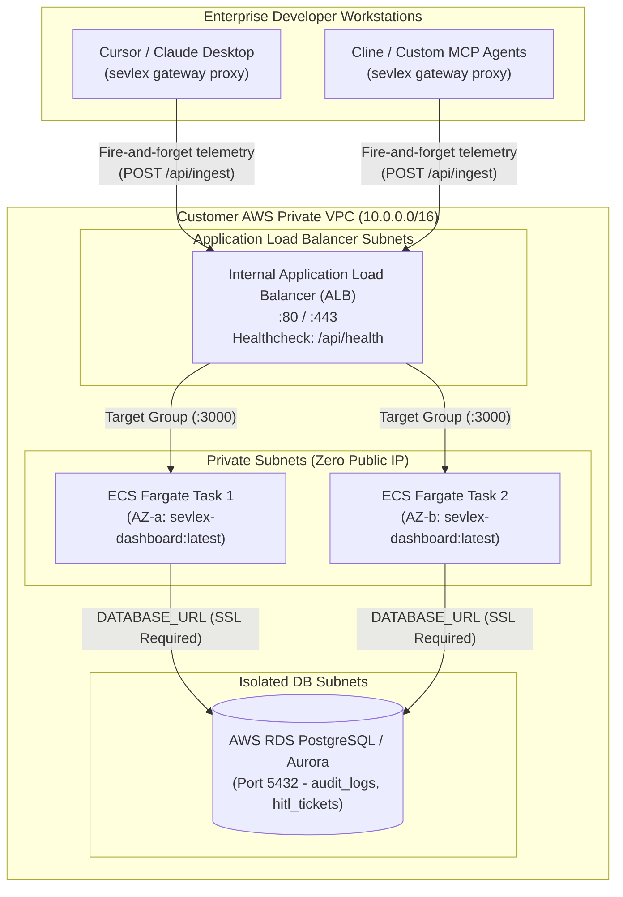

<div align="center">
  <h1>🛡️ Sevlex</h1>
  <p><b>Enterprise Layer 7 Zero-Trust Security Gateway & Control Plane for the Model Context Protocol (MCP)</b></p>
  <p><i>Real-Time Deep Packet Inspection • AST Normalization & De-Obfuscation • Autonomous AgentGuard™ Circuit Breaker • In-Flight Output DLP • Dual-Custody Slack HITL • AWS ECS Fargate & Private VPC Native</i></p>

  <p>
    <a href="https://www.npmjs.com/package/sevlex"></a>
    
    
    
    
    
  </p>
</div>

---

## ⚡ Instant 1-Line Quickstart

Protect your developer workstations in 10 seconds:

```bash
# 1. Experience the instant 5-second Zero-Trust Shield Demo (no config needed):
npx sevlex demo

# 2. Transparently shield Claude Desktop, Cursor, Cline & Windsurf:
npx sevlex init

# 3. Verify security status and cryptographic audit integrity:
npx sevlex status
npx sevlex verify
```

---

## 🌟 Executive Overview

**Sevlex** is an enterprise-grade, Layer 7 Zero-Trust security gateway and runtime control plane designed to govern Model Context Protocol (MCP) tool executions across developer workstations, autonomous agent runtimes, and private AWS VPCs.

Sitting transparently between AI clients (Cursor, Claude Desktop, Windsurf, Cline, Claude Code) and downstream MCP servers, Sevlex performs sub-millisecond Deep Packet Inspection (DPI) on JSON-RPC 2.0 traffic over `stdio` and `SSE` streams. It arrests dangerous SQL injections, path traversals, and arbitrary shell executions, normalizes obfuscated attack payloads, redacts sensitive corporate credentials in-flight, breaks agent hallucination loops, and enforces dual-custody Human-In-The-Loop (HITL) sign-offs via 1-click Slack interactive cards.

---

## 🏛️ Enterprise Private VPC Architecture

Sevlex runs natively inside **your enterprise private AWS Virtual Private Cloud (VPC)**. No tool telemetry, source code snippets, or prompt arguments ever leave your enterprise network perimeter.



---

## 🥊 Competitive Parity Matrix

| Feature / Architecture Dimension | Sevlex Enterprise Gateway | Runlayer | Preloop | Traditional API Gateways (Kong / Envoy) |
| :--- | :---: | :---: | :---: | :---: |
| **Global Package Registry** | **✔ Live on npm (`sevlex`)** | ❌ Proprietary Binary | ❌ Git Clone Only | ✔ Global Package |
| **Layer 7 Parameter DPI (SQL, Shell, Traversal)** | **✔ Active In-Flight (<1ms)** | ⚠️ Server-Level | ✔ Policy Engine | ❌ L4 / REST HTTP Only |
| **AST Normalization & De-obfuscation** | **✔ Base64, Hex, Quote Evasion** | ❌ Regex Only | ❌ Regex Only | ❌ None |
| **In-Flight Output DLP (AWS, Stripe, PAT, SSN)** | **✔ Sub-millisecond Regex** | ⚠️ Partial | ⚠️ Pre-release | ❌ None |
| **AgentGuard™ Hallucination Loop Breaker** | **✔ Stateful (Velocity + Anomaly)** | ❌ None | ❌ None | ⚠️ Simple Rate Limiting |
| **1-Click Slack Dual-Custody HITL** | **✔ Native Block Kit Interactive** | ⚠️ Connector Auth Only | ✔ Slack Webhook | ❌ Manual Webhooks |
| **Enterprise Private VPC (AWS ECS Fargate)** | **✔ CloudFormation & Terraform** | ✔ Managed VPC | ❌ Manual Docker | ⚠️ Generic K8s |
| **Enterprise Database Standard** | **✔ Native PostgreSQL 16 / RDS** | ✔ Postgres | ⚠️ SQLite / JSON | ✔ RDBMS |
| **Cryptographic Merkle Hash Chain** | **✔ SHA-256 Non-Repudiation** | ❌ Centralized SaaS Logs | ❌ Standard JSON Logs | ❌ External SIEM Dependent |
| **Zero-Touch Client Auto-Patcher (`sevlex inject`)** | **✔ 6 AI Clients Supported** | ⚠️ Proprietary Agent | ❌ Manual Config | ❌ Not Supported |

---

## 🛡️ Core Security Capabilities

### 1. ToolGuard™ Deep Parameter Guard & AST De-obfuscation
* **AST Normalization**: Attackers attempt to bypass regex filters using shell quote evasion (`r""m -r""f`), SQL block comments (`DROP/**/TABLE`), Base64 payloads, hex escapes (`\x72\x6d`), and JavaScript bracket property lookups (`globalThis["pro" + "cess"]["en" + "v"]`). ToolGuard recursively normalizes arguments into an Abstract Syntax Tree before inspection.
* **Parameter Guard**: Intercepts `tools/call` JSON-RPC payloads before execution. Blocks dangerous destructive SQL commands (`DROP TABLE`, `TRUNCATE`, `ALTER TABLE`), command injection primitives (`; rm -rf`, `&& cat /etc/shadow`), and directory traversal (`../../.ssh/id_rsa`).
* **In-Flight Output DLP**: Intercepts downstream MCP responses before the LLM ingests them. Redacts high-entropy AWS access keys (`AKIA...`), Stripe live tokens (`sk_live_...`), GitHub Personal Access Tokens (`ghp_...`), and Social Security Numbers (`SSN`).

### 2. AgentGuard™ Autonomous Circuit Breaker
Designed to eliminate catastrophic autonomous AI agent runaway failure modes:
* **Velocity Limiter**: Halts sessions exceeding 25 tool calls per 30 seconds.
* **Consecutive Failure Breaker**: Automatically trips when an agent encounters 5 consecutive permission failures.
* **Identical Call Loop Breaker**: Detects runaway hallucinations when an agent re-executes the exact same tool and arguments 3 consecutive times. Returns standard JSON-RPC `-32002` error codes so agents pause gracefully.

### 3. Dual-Custody HITL Closed Clearance Loop with 1-Click Slack Action Buttons
* Protected high-impact tools (`drop_database`, `github_merge_to_main`, `aws_terminate_instance`) are automatically suspended.
* Dispatches a rich Slack Block Kit card to `#secops-alerts` with action buttons: `[ ✅ Authorize (15m Window) ]` and `[ ❌ Reject & Terminate ]`.
* SecOps authorizes with one tap on their laptop or phone. Slack sends an interactive event to `/api/hitl/slack`, updating the card in-place with an immutable cryptographic signature.
* Retrying agents are granted seamless execution; clearances are atomically consumed (`CONSUMED`) to guarantee anti-replay security.

### 4. Cryptographic SHA-256 Merkle Audit Chain (Tamper-Evident Non-Repudiation)
Every execution receipt recorded in SQLite WAL mode is mathematically bound to its predecessor:
$$\text{entry\_hash} = \text{SHA256}(\text{prev\_hash} \parallel \text{id} \parallel \text{user\_id} \parallel \text{tool\_name} \parallel \text{status} \parallel \text{raw\_request} \parallel \text{timestamp})$$
Run `sevlex verify` at any time to mathematically audit the entire history. Any database record alteration, tampering, or deletion breaks the hash chain instantly.

---

## 🚀 Deployment Modalities

### Option A: Local SecOps Proof-of-Concept (Docker Compose)
Test the entire enterprise stack (PostgreSQL 16 + Gateway + Next.js Dashboard) in 30 seconds on a single machine or EC2 VM:

```bash
# Clone and boot the complete container stack
git clone https://github.com/Sevlex/sevlex-mcp-gateway.git
cd sevlex-mcp-gateway
docker compose up -d

# Verify container health
curl -f http://localhost:3000/api/health
```
Access the SecOps Web UI at **`http://localhost:3000`** *(Admin Key: `sevlex_secret_123`)*.

---

### Option B: Enterprise Private VPC Deployment (AWS ECS Fargate)
Deploy a serverless, multi-AZ, zero-egress cluster directly inside your enterprise AWS VPC:

1. **Initialize your AWS RDS PostgreSQL database**:
   ```bash
   psql -h rds-endpoint.internal -U sevlex_admin -d sevlex -f deploy/init.sql
   ```
2. **Deploy via AWS CloudFormation (1-Click)**:
   ```bash
   aws cloudformation create-stack \
     --stack-name sevlex-production \
     --template-body file://deploy/aws-ecs/cloudformation.yaml \
     --parameters \
         ParameterKey=VpcId,ParameterValue=vpc-0123456789abcdef0 \
         ParameterKey=PrivateSubnetIds,ParameterValue="subnet-aaa,subnet-bbb" \
         ParameterKey=AlbSubnetIds,ParameterValue="subnet-ccc,subnet-ddd" \
         ParameterKey=ContainerImage,ParameterValue=<ACCOUNT_ID>.dkr.ecr.us-east-1.amazonaws.com/sevlex/dashboard:latest \
         ParameterKey=RdsEndpoint,ParameterValue=rds-sevlex.internal \
         ParameterKey=RdsPassword,ParameterValue="<SECURE_PASSWORD>" \
         ParameterKey=AdminApiKey,ParameterValue="<ENTERPRISE_SECRET_KEY>" \
     --capabilities CAPABILITY_IAM
   ```
   *(Or deploy using our Terraform module in [`deploy/aws-ecs/terraform/`](deploy/aws-ecs/terraform/)).*

See our complete [Enterprise AWS ECS Deployment Guide](deploy/aws-ecs/README.md) for detailed VPC topologies and IAM permissions.

---

## ⚡ CLI Command Reference

Sevlex includes a unified enterprise CLI (`sevlex`):

```bash
# Auto-patch and wrap MCP servers across all detected AI runtimes
sevlex inject

# Unhook Sevlex and atomically restore original client configs from backup
sevlex restore

# Cryptographically verify the SHA-256 Merkle audit chain non-repudiation
sevlex verify

# Query active dual-custody HITL clearance tickets
sevlex hitl

# Inspect endpoint security health, active policies, and shielded runtimes
sevlex status

# Discover unmanaged shadow AI MCP servers across all user profiles
sevlex scan

# Launch remote MCP Server-Sent Events (SSE) reverse proxy
sevlex sse 8080 http://localhost:3001/sse

# Launch 24/7 background watcher daemon with 30ms tamper auto-healing
sevlex daemon

# Execute target tool transparently wrapped by Layer 7 zero-trust proxy
sevlex npx -y @modelcontextprotocol/server-github
```

---

## 🧪 Live Simulation & E2E Verification Suite

Verify all 9 enterprise attack and defense scenarios in real time:

```bash
cd gateway
npm test
```

```
======================================================================
   SEVLEX ZERO-TRUST MCP GATEWAY: LIVE END-TO-END SIMULATION RUNNER   
======================================================================
Architecture: AI Client (Simulated) -> Sevlex Gateway (L7 DPI) -> Enterprise MCP Server

[1/8] Connected to SQLite Audit Log: 10397 receipts found
[2/8] Spawning Sevlex L7 Security Gateway...
----------------------------------------------------------------------
SCENARIO 1: Real-Time Protocol Discovery (tools/list)               ✓ ALLOWED
SCENARIO 2: Authorized Legitimate Execution (postgres_query)         ✓ ALLOWED
SCENARIO 3: Parameter Guard Block - Destructive SQL (DROP TABLE)     🛡️ BLOCKED (<1ms)
SCENARIO 4: Parameter Guard Block - Command Injection (rm -rf /)     🛡️ BLOCKED (<1ms)
SCENARIO 5: Parameter Guard Block - Path Traversal (.ssh/id_rsa)     🛡️ BLOCKED (<1ms)
SCENARIO 6: AgentGuard™ Dual-Custody HITL Clearance Loop            🔒 HITL CLEARED
SCENARIO 7: In-Flight Output DLP (AWS, Stripe, SSN, PAT)             🔒 REDACTED
SCENARIO 8: CodeGuard AST Loop Interceptor (Cloudflare API)          🛡️ BLOCKED
SCENARIO 9: AgentGuard™ Autonomous Loop Circuit Breaker              ⚡ TRIPPED & FROZEN
======================================================================
🔒 CRYPTOGRAPHIC AUDIT INTEGRITY: 100% VALID (SHA-256 Merkle Chain)
★ ALL RUNLAYER PARITY & ARCHITECTURAL CHECKS PASSED! ★
```

---

## ⚙️ Configuration (`sevlex.json`)

Sevlex dynamically hot-reloads its configuration in `<5ms` without process restarts:

```json
{
  "version": "1.0.2",
  "policy": {
    "defaultAction": "ALLOW",
    "blockedTools": [
      "delete_database",
      "drop_table",
      "exfiltrate_keys",
      "execute_arbitrary_shell"
    ],
    "approvalRequiredTools": [
      "github_list_pull_requests",
      "stripe_bulk_refund",
      "aws_terminate_instance"
    ],
    "parameterRules": {
      "bash_execute": {
        "blockedPatterns": [
          "rm\\s+-rf\\s+/",
          "cat\\s+~/.ssh",
          ":\\(\\)\\{ :\\|:& \\};:"
        ]
      }
    },
    "dlp": {
      "redactAwsKeys": true,
      "redactStripeKeys": true,
      "redactGitHubTokens": true,
      "redactSsn": true
    },
    "siem": {
      "enabled": true,
      "provider": "datadog",
      "endpoint": "https://http-intake.logs.us5.datadoghq.com/api/v2/logs"
    }
  }
}
```

---

## 📄 Governance, Security & License

- **License:** Distributed under the [Apache 2.0 License](LICENSE).
- **Vulnerability Reporting:** See our [Security Policy](SECURITY.md) for coordinated disclosure.
- **Contributing:** See our [Contribution Guidelines](CONTRIBUTING.md) and [Code of Conduct](CODE_OF_CONDUCT.md).
- **Architect & Maintainer:** **Meet Panchal** & Sevlex Core Contributors.
