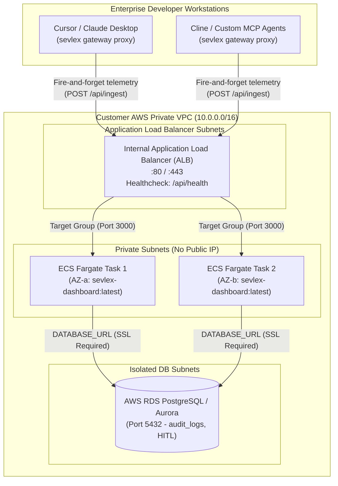

# 🛡️ Sevlex Enterprise: AWS ECS Fargate & Private VPC Deployment Guide

> **Zero-Trust AI Agent Security Architecture inside Customer's AWS VPC**  
> *SOC2 Type II, HIPAA, and ISO 27001 Compliant • Zero Data Egress • Multi-AZ High Availability*

---

## 🏛️ Enterprise VPC Architecture

Sevlex runs directly inside **your own private AWS Virtual Private Cloud (VPC)**. No tool telemetry, source code snippets, or prompt arguments ever leave your enterprise network perimeter.



---

## ⚖️ Deployment Modalities: Docker Compose vs AWS ECS Fargate

| Capability | Local Sandbox (`docker-compose.yml`) | Enterprise Production (AWS ECS Fargate) |
| :--- | :--- | :--- |
| **Primary Use Case** | 30-Second SecOps Proof-of-Concept / Local Dev | Enterprise Production Rollout (100–10,000+ seats) |
| **Compute Primitive** | Docker Engine on local machine / single EC2 | Serverless AWS Fargate (Zero OS patching) |
| **High Availability** | Single instance (SPOF) | Multi-AZ (Active-Active load balanced tasks) |
| **Database** | Containerized PostgreSQL 16 (`deploy/init.sql`) | Managed AWS RDS PostgreSQL / Aurora |
| **Networking** | Docker Bridge Network (`sevlex-net`) | AWS VPC Private Subnets (`awsvpc` network mode) |
| **Load Balancing** | Port mapping (`localhost:3000`) | AWS Application Load Balancer with SSL termination |
| **Compliance Readiness** | Developer testing only | SOC2 Type II, HIPAA, ISO 27001, FedRAMP High |

---

## 🚀 3-Step Deployment Workflow

### Step 1: Push Container Image to Amazon ECR
```bash
# 1. Authenticate Docker with your AWS ECR Registry
aws ecr get-login-password --region us-east-1 | docker login --username AWS --password-stdin <ACCOUNT_ID>.dkr.ecr.us-east-1.amazonaws.com

# 2. Build and tag the production container image
docker build -t sevlex-dashboard:latest -f dashboard/Dockerfile ./dashboard
docker tag sevlex-dashboard:latest <ACCOUNT_ID>.dkr.ecr.us-east-1.amazonaws.com/sevlex/dashboard:latest

# 3. Push to private ECR repository
docker push <ACCOUNT_ID>.dkr.ecr.us-east-1.amazonaws.com/sevlex/dashboard:latest
```

### Step 2: Initialize Enterprise PostgreSQL Database
Connect to your internal AWS RDS PostgreSQL instance and execute the initialization DDL:
```bash
psql -h <RDS_ENDPOINT> -U sevlex_admin -d sevlex -f deploy/init.sql
```

### Step 3: Launch via AWS CloudFormation or Terraform

#### Option A: AWS CloudFormation (1-Click)
```bash
aws cloudformation create-stack \
  --stack-name sevlex-enterprise-production \
  --template-body file://deploy/aws-ecs/cloudformation.yaml \
  --parameters \
      ParameterKey=VpcId,ParameterValue=vpc-0123456789abcdef0 \
      ParameterKey=PrivateSubnetIds,ParameterValue="subnet-aaa,subnet-bbb" \
      ParameterKey=AlbSubnetIds,ParameterValue="subnet-ccc,subnet-ddd" \
      ParameterKey=ContainerImage,ParameterValue=<ACCOUNT_ID>.dkr.ecr.us-east-1.amazonaws.com/sevlex/dashboard:latest \
      ParameterKey=RdsEndpoint,ParameterValue=rds-sevlex.internal \
      ParameterKey=RdsPassword,ParameterValue="<SECURE_PASSWORD>" \
      ParameterKey=AdminApiKey,ParameterValue="<ENTERPRISE_SECRET_KEY>" \
  --capabilities CAPABILITY_IAM
```

#### Option B: Terraform
```bash
cd deploy/aws-ecs/terraform
terraform init
terraform apply \
  -var="vpc_id=vpc-0123456789abcdef0" \
  -var="private_subnet_ids=[\"subnet-aaa\",\"subnet-bbb\"]" \
  -var="alb_subnet_ids=[\"subnet-ccc\",\"subnet-ddd\"]" \
  -var="container_image=<ACCOUNT_ID>.dkr.ecr.us-east-1.amazonaws.com/sevlex/dashboard:latest" \
  -var="rds_endpoint=rds-sevlex.internal" \
  -var="rds_password=<SECURE_PASSWORD>" \
  -var="admin_api_key=<ENTERPRISE_SECRET_KEY>"
```

---

## 🔒 Zero Egress Guarantee
When deployed via this template:
- `AssignPublicIp: DISABLED` ensures ECS tasks cannot be reached from the public internet.
- Tasks communicate exclusively with internal RDS and Internal ALB over private VPC subnets.
- Telemetry forwarders in client gateways connect to the Internal ALB endpoint (`http://sevlex-internal-alb.internal/api/ingest`).
- **Zero third-party SaaS cloud services are contacted.**
